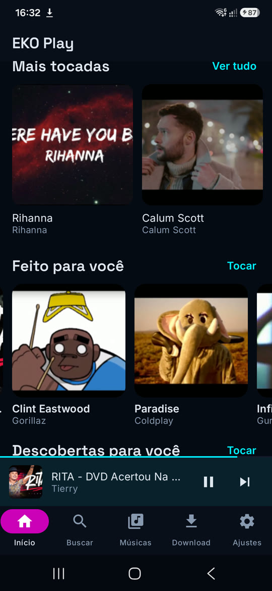
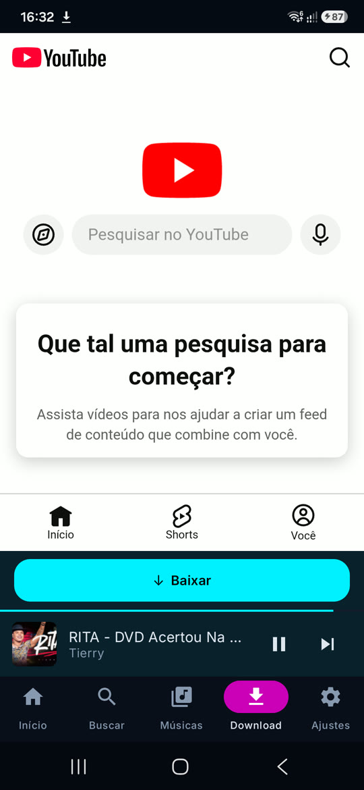
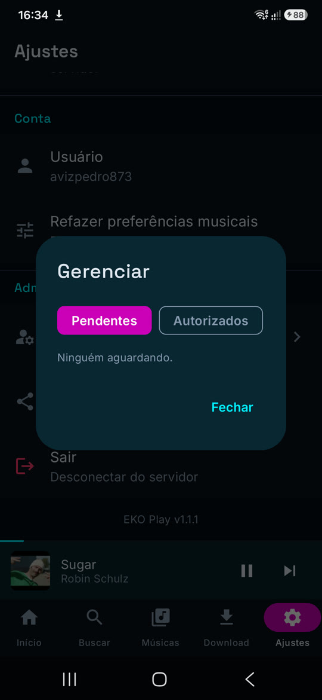

# EKO Play

Servidor de música caseiro com app Android próprio: baixa do YouTube para o seu
computador, organiza a biblioteca e toca no celular de quem você autorizar.

Roda na sua máquina. Não é nuvem, não tem assinatura, não tem anúncio.

| Início | Baixar | Administração |
|---|---|---|
|  |  |  |

---

## Como funciona

```
celular (EKO Play)                     seu computador
┌────────────────────┐    HTTPS    ┌──────────────────────────┐
│ navegador YouTube  │ ──────────► │ servidor.py (API + fila) │
│ botão Baixar       │             │   ├─ yt-dlp (download)   │
│ player + downloads │ ◄────────── │   ├─ dedupe / catálogo   │
└────────────────────┘  streaming  │   └─ Navidrome (acervo)  │
                                   │        └─ music/         │
                                   └──────────────────────────┘
```

O app é um navegador restrito ao YouTube com um botão de baixar. O servidor recebe
o link, baixa, evita duplicata e indexa no Navidrome. O mesmo app toca a biblioteca
pelo Navidrome e administra quem tem acesso.

## Recursos

- **Baixar música ou vídeo** direto do celular.
- **Playlist inteira** de uma vez; as faixas já existentes entram na playlist sem
  serem baixadas de novo.
- **Dedupe em três níveis**: ID do vídeo, metadados (±4 s) e impressão digital
  de áudio (Chromaprint).
- **Playlists automáticas**: `Baixadas - <nome>` por pessoa e `Nome da playlist`
  por lista baixada.
- **Administração no app**: aprovar entrada, promover/remover administrador.
- **Login com Google** ou entrada por aprovação, com HTTPS e chaves por aparelho.
- **Login alternativo** por usuário e senha do Navidrome, para quem prefere não
  usar Google.

## Instalação

1. **Computador** — Python 3.11+, ffmpeg, fpcalc e Navidrome.
   Passo a passo em [docs/INSTALACAO.md](docs/INSTALACAO.md).
2. **Primeiro administrador** — abra o app e use a tela "Primeiro acesso" com a
   senha definida em `config.json`.
3. **Celular** — instale em `/instalar` do seu servidor (ou compile, em
   [docs/APP.md](docs/APP.md)).
4. **Fora de casa** (opcional) — Cloudflare Tunnel, ngrok ou só na rede local:
   [docs/TUNEL.md](docs/TUNEL.md).

Prefere instalar conversando com uma IA? Use o roteiro em
[docs/PROMPT-IA.md](docs/PROMPT-IA.md).

## Segurança

Acesso só para quem o dono liberar. Cada aparelho recebe uma chave aleatória de
256 bits (guardada como hash), há limite de tentativas, bloqueio temporário e o
servidor valida o token do Google antes de criar a sessão. Detalhes e o modelo de
papéis em [docs/SEGURANCA.md](docs/SEGURANCA.md).

## Estrutura

```
server/   API, fila de downloads e motor (Python)
app/      app Android (Kotlin + Compose + Media3)
docs/     instalação, app, segurança, túnel e prompt para IA
```

## Desenvolvimento

Servidor:

```bash
cd server
python -m venv .venv && .venv/bin/pip install -r requirements.txt
.venv/bin/python servidor.py
```

App:

```bash
cd app
./gradlew assembleDebug
```

## Status

Uso pessoal e familiar, em evolução. Ideias na lista: capas e nomes vindos de
metadados mais ricos, suporte a filmes, e um instalador guiado.

## Licença

MIT. Veja [LICENSE](LICENSE).

> Baixar conteúdo do YouTube pode contrariar os Termos de Uso do serviço. Use com
> conteúdo que você tem direito de baixar. O projeto não hospeda nem distribui
> mídia.
